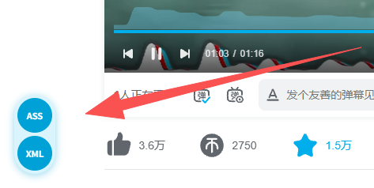

<div align="center">
    
    <h1>BiliBili-弹幕下载 <code>v1.3</code></h1>
    <p>
        <a href='https://github.com/MehverSynRGB/BiliBili-DownloadDanmaku'></a>
        <a href='https://greasyfork.org/scripts/589645'></a>
    </p>
</div>

## 简介

在B站视频、番剧、电影、纪录片页面默认左下角，通过悬浮按钮下载 ASS 字幕或原版 XML 弹幕。



- 支持 AV/BV 号视频
- 支持通过 `?p=` 参数准确下载多 P 视频的当前分 P 弹幕
- 支持番剧、电影、纪录片（PGC 页面）
- ASS 从 Protobuf view/seg.so 接口分段获取弹幕，并尝试获取特殊弹幕包（BAS 等）
- 导出标准 ASS 字幕格式，支持滚动/顶部/底部弹幕
- XML 直接下载 `comment.bilibili.com/{cid}.xml` 的原始响应；接口返回范围不保证与 ASS 相同，也不保证包含全部弹幕

## 使用

打开B站视频/番剧页面，在默认左下角的竖向胶囊中点击 **ASS** 下载字幕，或点击 **XML** 下载原版弹幕。按钮可使用键盘操作，同一时间只能进行一个下载。

在脚本管理器菜单中选择“设置下载文件名前缀”可为导出文件添加任意前缀；默认不添加前缀，留空可恢复默认。

选择“设置悬浮按钮位置”可输入 `x,y`（也支持中文逗号），单位为像素，坐标原点 `0,0` 为浏览器视口左下角的留边位置；默认 `10,10`，X 向右、Y 向上为正。例如 `100,50` 相对原点向右移动 100 像素、向上移动 50 像素。支持小数和负数，留空恢复默认 `10,10`，取消不修改。设置保存后立即生效，刷新或重新注入后仍然保留。显示位置会限制在视口内并尽量保留 8 像素边距；视口过小时尽量完整显示，窗口大小变化时重新计算，但不会修改保存的原始坐标。

也可在浏览器控制台中调用：

```js
__bili_dm_dl__()
```
